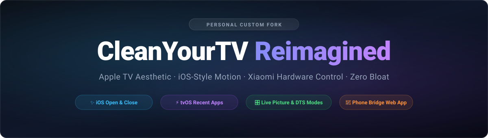

### Visual Showcase

**See it running on a real TV.** Every screenshot and recording below was captured directly from a Xiaomi Smart TV 4K, not a mockup and not an emulator.

---

## About this fork

**CleanYourTV Reimagined** is a personal, customized fork of the CleanYourTV launcher by Gathin. It keeps the lightweight spirit of the original and adds iOS-style motion, fluid focus, tvOS-style Recents, a smart boot intro, and a phone-based remote.

> This is an unofficial fork. It isn't affiliated with or endorsed by Gathin or the original CleanYourTV project. The banner above is original artwork made for this fork and doesn't reuse the original logo. Please see the upstream project's license for the terms that apply to the code.

**Captured on:** Xiaomi Smart TV 4K (`MiTV_MZTU0`, Android 14)

---

## Motion in action

Three short 1080p recordings show the part screenshots can't: how it moves.

| Recording | Length / Size | What you'll see |
|---|---|---|
| **[`anim_open_and_close_app.mp4`](anim_open_and_close_app.mp4)** | ~8s (8.45 MB) | **iOS-style open and close.** The focused YouTube tile gives a tactile press dip, then expands into a fullscreen curtain. Press Home and the window shrinks smoothly back into the dock tile it came from. |
| **[`anim_glide_focus.mp4`](anim_glide_focus.mp4)** | ~9s (4.13 MB) | **Gliding focus.** One morphing pill travels across the top capsules (`Inputs` → `Wi-Fi` → `Reorder` → `Settings`), then Quick Settings opens and a vertical focus bar glides between options. |
| **[`anim_intro_reveal.mp4`](anim_intro_reveal.mp4)** | ~6s (162 KB) | **Boot and wake intro.** The wordmark enters, the greeting holds, and a circular aperture opens into the Home screen. |

---

## Screenshots

Captured in 4K. Click any preview to open the full-resolution image.

| Preview | Feature |
|:---:|---|
|  | **Home** A clean, Apple TV-inspired Home with a bird wallpaper, live Lonavala weather (`26°C SUNNY`), time and date, a unified status capsule (`RAM 67%`, `Storage 28%`, `Remote Battery 87%`, connected `CMF Buds`), and a custom dock. [`01_home_screen.png`](01_home_screen.png) |
|  | **Boost card** The System & Accessories popup, with live RAM and Storage progress bars, a `Memory & Storage Boost` button, a battery monitor, and a shortcut to Bluetooth settings. [`02_unified_boost_card.png`](02_unified_boost_card.png) |
|  | **Quick Settings** A side panel that reads the TV's real state: Picture mode (`Standard`), Audio mode (`DTS: Clarity + Virtualizer`), Network, and the connected Bluetooth audio device (`CMF Buds`). [`03_quick_settings_modes.png`](03_quick_settings_modes.png) |
|  | **Recents** A tvOS-style Recent Apps menu, opened with a long press on Home. It lists running user apps (TizenTube, Cx File Explorer, CPU Info) with per-app RAM badges, a total memory pill (`Free: 541 MB / 1.7 GB`), and `Close App` / `Close All` actions. [`04_recent_apps_menu.png`](04_recent_apps_menu.png) |
|  | **Animation settings** Tune the iOS-style launch animation: speed, easing curve, background depth, card artwork morph, and a live preview. [`05_app_launch_settings.png`](05_app_launch_settings.png) |
|  | **Intro settings** Customize the boot and wake intro: wake gap threshold, hold duration (Auto or timed), animation style presets, and message modes. [`06_intro_settings.png`](06_intro_settings.png) |
|  | **Phone Bridge** Pair your phone with the TV. The screen shows the endpoint URL (`http://192.168.1.37:8765`), a 5-minute security PIN, and a live QR code to scan. [`07_phone_bridge_pairing.png`](07_phone_bridge_pairing.png) |
|  | **Inputs** A frosted, translucent inputs popup with a morphing pill highlight over `Ashu's laptop · HDMI 1`, HDMI 2, HDMI 3, and AV. [`08_translucent_inputs_menu.png`](08_translucent_inputs_menu.png) |

---

## Good to know

- **Real hardware only.** All captures come from the live TV. Screenshots are pulled over ADB with `adb exec-out screencap -p`.
- **Built for one TV, tuned on it.** The Xiaomi-specific features (live picture and sound modes) depend on Xiaomi's TV middleware. Other Android TVs may work, but those parts will fall back quietly.
- **Same folder, same names.** The file names above are referenced directly, so keep the images and videos next to this README.

---

**CleanYourTV Reimagined** · a personal fork built on CleanYourTV by Gathin

Unofficial and not affiliated with the original project. Check the upstream license before reusing or redistributing anything.

