# App Open Loading Animation & Global Overlay Intro Implementation Plan

> **For agentic workers:** REQUIRED SUB-SKILL: Use superpowers:subagent-driven-development (recommended) or superpowers:executing-plans to implement this plan task-by-task. Steps use checkbox (`- [ ]`) syntax for tracking.

**Goal:** Provide an engaging, pulsing loading message on the black launch curtain during cold app launches, and render custom prank/wake intros globally over *any* running application via `HomeKeyService` (`TYPE_ACCESSIBILITY_OVERLAY`) with a circular aperture reveal, preserving the user's active app without forcing navigation to the Home screen.

**Architecture:**
1. **Launch Curtain Loading Typography:** Enhance [LaunchCurtainController.java](file:///C:/Users/Ashirwad/Desktop/projects/clean%20your%20tv%20-%20enhanced/launcher/app/src/main/java/com/gathin/tvhome/LaunchCurtainController.java) and [activity_main.xml](file:///C:/Users/Ashirwad/Desktop/projects/clean%20your%20tv%20-%20enhanced/launcher/app/src/main/res/layout/activity_main.xml) with a centered, hardware-accelerated loading view (`launchCurtainLoadingLayout`). Once the expanding curtain reaches full black (`u = 1.0f`), the target app label (e.g. "Opening YouTube...") smoothly fades in with a gentle breathing pulse until the target activity gains window focus or the launch is cancelled/timed out.
2. **Global Intro System via Accessibility Overlay:** Leverage [HomeKeyService.java](file:///C:/Users/Ashirwad/Desktop/projects/clean%20your%20tv%20-%20enhanced/launcher/app/src/main/java/com/gathin/tvhome/HomeKeyService.java), which already holds system-level `TYPE_ACCESSIBILITY_OVERLAY` capabilities. `HomeKeyService` dynamically mounts [BootIntroOverlay.java](file:///C:/Users/Ashirwad/Desktop/projects/clean%20your%20tv%20-%20enhanced/launcher/app/src/main/java/com/gathin/tvhome/BootIntroOverlay.java) directly onto `WindowManager`. The intro text and circular aperture reveal (`canvas.clipOutPath`) animate directly on top of whatever application the user is currently running.
3. **Non-Intrusive Bridge Custom Intro:** Decouple `POST /intro` in [BridgeHttpServer.java](file:///C:/Users/Ashirwad/Desktop/projects/clean%20your%20tv%20-%20enhanced/launcher/app/src/main/java/com/gathin/tvhome/bridge/BridgeHttpServer.java) from `MainActivity` when an external app is frontmost. Instead of injecting `adb keyevent 3` (Home) and reordering `MainActivity` to the front, the bridge triggers `HomeKeyService.displayGlobalIntro(...)`. When the intro finishes, the circular aperture expands and reveals the user's active app underneath without any task interruption.
4. **App-Persistent Screensaver Wake Detection:** Track screensaver dismissal (`DREAMING_STOPPED` and `frontDreamActive` transitions) inside `HomeKeyService`. When a screensaver exits while the user is over a third-party app (e.g. YouTube), evaluate `intro_on_wake` and the wake gap via [BootIntro.java](file:///C:/Users/Ashirwad/Desktop/projects/clean%20your%20tv%20-%20enhanced/launcher/app/src/main/java/com/gathin/tvhome/BootIntro.java). If eligible, immediately trigger the wake greeting overlay on top of the app, clear the dream state, and update the wake timestamp so Home doesn't duplicate the intro later.

```mermaid
flowchart TD
    subgraph AppOpen["1. App Open Loading Text"]
        Click[User Clicks App Card] --> Expand[Curtain Expands from Card Bounds]
        Expand --> FullBlack[Curtain Reaches Fullscreen u=1.0]
        FullBlack --> StartAct[startActivity targetIntent]
        FullBlack --> FadeInText[Loading Text Fades In: 'Opening YouTube...']
        FadeInText --> Pulse[Subtle Breathing Pulse Animation]
        StartAct --> TargetLoaded{Target App Resumed?}
        TargetLoaded -- Yes --> DismissText[Clean Instant Dismiss & Reset]
        TargetLoaded -- No / Back Pressed --> CancelLaunch[Curtain Cleared]
    end

    subgraph BridgeIntro["2. Custom Intro (Bridge Phone App)"]
        BridgeReq["Phone triggers POST /intro"] --> CheckActive{"Is MainActivity in Front?"}
        CheckActive -- Yes --> MainIntro["Play on MainActivity (Dock slide)"]
        CheckActive -- No --> GlobalOverlay["HomeKeyService.displayGlobalIntro(...)"]
        GlobalOverlay --> WMAdd["WindowManager.addView(TYPE_ACCESSIBILITY_OVERLAY)"]
        WMAdd --> AnimOverApp["Intro animates directly over active app"]
        AnimOverApp --> CircularReveal["Circular aperture opens, revealing active app"]
        CircularReveal --> WMRemove["WindowManager.removeView(...)"]
        WMRemove --> KeepApp["User continues in their app seamlessly"]
    end

    subgraph WakeIntro["3. Screensaver Wake over App"]
        Dreaming["Screensaver active over third-party app"] --> DismissDream["User presses OK/Exit remote button"]
        DismissDream --> StateChange["HomeKeyService detects dream exit"]
        StateChange --> CheckWakeGap{"intro_on_wake & wake gap met?"}
        CheckWakeGap -- Yes --> GlobalWake["HomeKeyService.displayGlobalWakeIntro()"]
        CheckWakeGap -- No --> ResumeAppDirect["Directly resume app"]
        GlobalWake --> WakeOverlay["Circular reveal over app & clear wake state"]
        WakeOverlay --> NoDuplicate["Home pressed later: NO duplicate wake intro"]
    end
```



**Tech Stack:**
- Android 9–14 (Android TV Leanback, API 28+)
- Java 17 / Android SDK
- `WindowManager.LayoutParams.TYPE_ACCESSIBILITY_OVERLAY` with `PixelFormat.TRANSLUCENT`
- Android Hardware-Accelerated Canvas clipping (`clipOutPath`)
- ValueAnimator / Property Animation
- NanoHTTPD (Bridge Server)

**Spec / Requirements:**
- User prompt:
  1. Add loading text on the black curtain overlay that displays after the app open animation commences, giving patience and visual engagement.
  2. For custom intro triggered from the bridge: display the black overlay and custom text on *any* screen without taking the user to the Home screen, cleanly revealing the current app at the end.
  3. When screensaver starts and exits over an app, show the wake intro directly over that app (not waiting until Home is pressed later), and ensure the circular aperture reveals the active app.

---

## Global Constraints

- **Platform Target:** Android TV 9 through 14 (tested directly on Xiaomi MiTV MZTU0, Android 14).
- **No Background Regressions:** Do NOT break or disrupt existing tile launch physics, card morphs, D-pad navigation, Recents carousel, or Quick Settings handoffs.
- **Accessibility Safety:** Overlays mounted by `HomeKeyService` must be `FLAG_NOT_FOCUSABLE` (or properly consume remote input during display to prevent accidental underlying clicks) and MUST cleanly remove themselves from `WindowManager` on completion, error, timeout, or service destruction.
- **Leak Prevention:** Any `ValueAnimator`, `Handler` callback, or `Bitmap` allocated during curtain or intro playback must be deterministically cancelled and nulled upon `clearImmediate()`, `onPause()`, `onStop()`, or `onDestroy()`.

---

## Review Focus

1. **Slow App Cold Starts vs Immediate Back Key:** If an app launch takes 4 seconds, the loading text pulses steadily. If the user presses the Back button 1 second in, the loading text and curtain must fade out immediately without delay or UI freeze.
2. **App Crash on Start:** If `startActivity()` fails (e.g. `ActivityNotFoundException`) or hangs indefinitely, the loading text must not remain stuck on screen forever; it must reset cleanly on timeout.
3. **Bridge Intro While Media Playing:** If the user is watching a video in YouTube, a custom intro from the Bridge must show text, pause/suppress accidental remote clicks during the hold, and reveal the playing video without pausing playback or resetting the activity stack.
4. **Screensaver Wake Race Conditions:** If the user dismisses the screensaver and immediately presses Home within 100ms, the intro should cleanly play once without double-triggering or overlapping two intro overlays.
5. **Memory & Display Metrics in Accessibility Overlay:** `BootIntroOverlay` created in `HomeKeyService` must properly acquire screen dimensions and font assets even though it is instantiated with a Service context.

---

## Implementation Tasks

### Task 1: App Open Curtain Loading Text Animation

**Files:**
- Modify: `launcher/app/src/main/res/layout/activity_main.xml:456-477`
- Modify: `launcher/app/src/main/java/com/gathin/tvhome/AppAdapter.java:695-725`
- Modify: `launcher/app/src/main/java/com/gathin/tvhome/LaunchCurtainController.java:31-225, 835-860`
- Modify: `launcher/app/src/main/java/com/gathin/tvhome/MainActivity.java:3310-3345`
- Test: `launcher/app/src/test/java/com/gathin/tvhome/LaunchCurtainControllerTest.java` (create)

**Interfaces:**
- `AppAdapter.java`:
  - `String labelAt(int position)`: returns app name at position.
- `LaunchCurtainController.java`:
  - `void launch(View sourceView, float[] relBounds, boolean allowFallbackOrigin, CharSequence appLabel, AppAdapter.LaunchCommit commit)`
  - `void showLoadingText(CharSequence appLabel)`
  - `void hideLoadingTextImmediate()`

- [ ] **Step 1: Write unit tests for label resolution and loading state**
  Add unit tests in `LaunchCurtainControllerTest.java` asserting that:
  - `AppAdapter.labelAt(int)` returns the human-readable app label.
  - Curtain loading text formats as `"Opening " + label + "..."` when label is non-null, and `"Opening..."` when null.
  - Cleanup methods properly reset loading text visibility to `INVISIBLE` and cancel animators.

- [ ] **Step 2: Update `activity_main.xml` to include loading container in `launchCurtain`**
  Inside `launchCurtain` `FrameLayout` (after `launchCurtainArt`), add:
  ```xml
  <LinearLayout
      android:id="@+id/launchCurtainLoadingLayout"
      android:layout_width="wrap_content"
      android:layout_height="wrap_content"
      android:layout_gravity="center"
      android:orientation="vertical"
      android:gravity="center"
      android:alpha="0"
      android:visibility="invisible"
      android:importantForAccessibility="no">

      <TextView
          android:id="@+id/launchCurtainLoadingText"
          android:layout_width="wrap_content"
          android:layout_height="wrap_content"
          android:textColor="#E6FFFFFF"
          android:textSize="22sp"
          android:letterSpacing="0.06"
          android:fontFamily="sans-serif-medium"
          android:gravity="center" />

      <TextView
          android:id="@+id/launchCurtainLoadingSubtext"
          android:layout_width="wrap_content"
          android:layout_height="wrap_content"
          android:layout_marginTop="8dp"
          android:textColor="#80FFFFFF"
          android:textSize="13sp"
          android:letterSpacing="0.04"
          android:fontFamily="sans-serif"
          android:gravity="center"
          android:text="Please wait a moment..." />
  </LinearLayout>
  ```

- [ ] **Step 3: Implement loading animation in `LaunchCurtainController.java`**
  - Bind `loadingLayout`, `loadingText`, `loadingSubtext` in constructor.
  - In `commitAfterExpand(...)`:
    When the curtain reaches full expansion and `commit.run(true)` is called, fade in `loadingLayout` (`alpha` 0 to 1 over 200ms).
    Start a subtle breathing `ValueAnimator` oscillating `alpha` between `0.65f` and `1.0f` on `loadingLayout`.
  - In `clearImmediate()`, `fadeOutForResume()`, `onPause()`, `onStop()`, and `finishCloseCleanup()`:
    Stop breathing animator, reset `loadingLayout.setAlpha(0f)` and set visibility to `INVISIBLE`.

- [ ] **Step 4: Update `MainActivity.java` launch calls to pass app label**
  In `MainActivity.launchApp(...)`, retrieve `adapter.labelAt(pos)` and pass it into `curtainController.launch(..., label, commit)`.

- [ ] **Step 5: Run tests and verify compile**
  Execute `gradlew.bat testDebugUnitTest` to confirm all tests pass.

---

### Task 2: Global Intro Overlay Infrastructure in `HomeKeyService` & `BootIntroOverlay`

**Files:**
- Modify: `launcher/app/src/main/java/com/gathin/tvhome/BootIntroOverlay.java:220-250, 600-640`
- Modify: `launcher/app/src/main/java/com/gathin/tvhome/HomeKeyService.java:90-110, 560-610`
- Test: `launcher/app/src/test/java/com/gathin/tvhome/HomeKeyServiceTest.java`

**Interfaces:**
- `BootIntroOverlay.java`:
  - `start(View content, View dock, Runnable completeCallback)`: safe for null `content` and `dock` with deferred layout listener for standalone `WindowManager` attachment.
  - `void setStandaloneOverlay(boolean standalone)`: optimizes cleanup when added directly to `WindowManager`.
- `HomeKeyService.java`:
  - `public static boolean showGlobalIntro(Context ctx, String title, String subtitle, String anim, int holdMs)`
  - `public void displayGlobalIntro(String title, String subtitle, String anim, int holdMs)`
  - `public void dismissGlobalIntroImmediate()`

- [ ] **Step 1: Write unit tests for `HomeKeyService` global intro lifecycle**
  Add tests in `HomeKeyServiceTest.java` verifying that:
  - `HomeKeyService.canDisplayGlobalIntro()` returns true when service is running.
  - Remote key events during global intro playback trigger `skip()` and consume the key event to protect the background app.

- [ ] **Step 2: Enhance `BootIntroOverlay.java` for standalone window execution**
  - In `start(...)`, detect if `getWidth() > 0 && getHeight() > 0`. If not yet laid out (common in standalone overlay windows before first frame), attach an `OnLayoutChangeListener` to invoke `setupMetrics()` and `startEntranceAnimation()` the instant dimensions are known.
  - In `finishSequence()` and `cleanup()`, ensure `onComplete.run()` is called reliably to notify the host service to call `WindowManager.removeView()`.

- [ ] **Step 3: Implement `displayGlobalIntro` in `HomeKeyService.java`**
  - Implement `displayGlobalIntro(String title, String subtitle, String anim, int holdMs)`:
    - Instantiate `BootIntroOverlay` with `HomeKeyService` context.
    - Set window parameters:
      ```java
      WindowManager.LayoutParams lp = new WindowManager.LayoutParams(
              WindowManager.LayoutParams.MATCH_PARENT,
              WindowManager.LayoutParams.MATCH_PARENT,
              WindowManager.LayoutParams.TYPE_ACCESSIBILITY_OVERLAY,
              WindowManager.LayoutParams.FLAG_NOT_FOCUSABLE
                      | WindowManager.LayoutParams.FLAG_LAYOUT_IN_SCREEN
                      | WindowManager.LayoutParams.FLAG_LAYOUT_NO_LIMITS,
              PixelFormat.TRANSLUCENT);
      ```
    - Add to `WindowManager` and start sequence.
    - On completion or skip, cleanly execute `wm.removeView(overlay)`.
  - In `onKeyEvent(KeyEvent event)`:
    If `globalIntroOverlay != null && globalIntroOverlay.isPlaying()`, on `ACTION_DOWN` trigger `globalIntroOverlay.skip()`, and return `true` so the key does not click anything in the active background app.
  - In `onDestroy()` and `onUnbind()`, call `dismissGlobalIntroImmediate()`.

- [ ] **Step 4: Run tests and verify compile**
  Execute `gradlew.bat testDebugUnitTest` to verify no regressions.

---

### Task 3: Bridge Custom Intro Route over Any Active Screen

**Files:**
- Modify: `launcher/app/src/main/java/com/gathin/tvhome/MainActivity.java:2690-2740`
- Modify: `launcher/app/src/main/java/com/gathin/tvhome/bridge/BridgeHttpServer.java:1050-1065`
- Test: `launcher/app/src/test/java/com/gathin/tvhome/bridge/BridgeHttpServerTest.java` (or standalone test)

**Interfaces:**
- `MainActivity.java`:
  - `public static boolean playCustomIntro(Context ctx, String title, String subtitle, String anim, int holdMs)`: Updated to check `isHomeResumedForOverlay()`. If false and `HomeKeyService` is running, delegate directly to `HomeKeyService.showGlobalIntro(...)` without launching `MainActivity` or sending Home key.

- [ ] **Step 1: Write unit tests for custom intro routing**
  Verify that when `MainActivity.isHomeResumedForOverlay()` is false, `playCustomIntro()` routes to `HomeKeyService` and does NOT launch `MainActivity` intent.

- [ ] **Step 2: Update `MainActivity.playCustomIntro`**
  - Check `MainActivity.isHomeResumedForOverlay()`.
  - If `MainActivity` is resumed in front, use existing `act.startCustomIntro(title, subtitle, anim, holdMs)` (with dock animation).
  - If `MainActivity` is NOT resumed (user is on YouTube, Netflix, or settings):
    Delegate to `HomeKeyService.showGlobalIntro(ctx, title, subtitle, anim, holdMs)`.
    Do NOT execute `adb.executeShell("input keyevent 3")`!
    Do NOT execute `startActivity(MainActivity)`!

- [ ] **Step 3: Run unit tests and verify build**
  Execute `gradlew.bat testDebugUnitTest`.

---

### Task 4: Screensaver Wake Detection & Intro Over Underlying Apps

**Files:**
- Modify: `launcher/app/src/main/java/com/gathin/tvhome/BootIntro.java:120-160, 270-330`
- Modify: `launcher/app/src/main/java/com/gathin/tvhome/LauncherMotion.java:394-405`
- Modify: `launcher/app/src/main/java/com/gathin/tvhome/HomeKeyService.java:340-379, 510-540`
- Test: `launcher/app/src/test/java/com/gathin/tvhome/BootIntroTest.java`
- Test: `launcher/app/src/test/java/com/gathin/tvhome/HomeKeyServiceTest.java`

**Interfaces:**
- `BootIntro.java`:
  - `public static IntroMessage pickIntroMessage(Context ctx, boolean isWake)`: Shared message selection helper.
  - `public static void recordWakePlayed(Context ctx)`: Updates `KEY_LAST_INTRO_TIME` and clears dream state.
- `HomeKeyService.java`:
  - `private void checkWakeIntroOverApp(String previousPkg, String newPkg)`: Handles dream exit over third-party apps.

- [ ] **Step 1: Write unit tests for screensaver wake evaluation**
  Add unit tests in `BootIntroTest.java` verifying that:
  - Wake gap is evaluated correctly for wake over apps.
  - `pickIntroMessage()` returns valid greeting based on time of day (morning, afternoon, evening, night).
  - `recordWakePlayed()` updates timestamp so subsequent Home key presses within the wake gap do not replay the intro.

- [ ] **Step 2: Expand screensaver package detection in `LauncherMotion.java`**
  In `isDreamWindowPackage(String pkg)`:
  Add `lower.contains("aerialviews")` and `lower.contains("backdrop")` to support Google TV Ambient Mode and Neil Turner / Furnaghan Aerial Views builds.

- [ ] **Step 3: Implement dream exit detection in `HomeKeyService.java`**
  - In `onAccessibilityEvent(AccessibilityEvent event)`:
    Detect transition where `frontDreamActive` was `true` and now becomes `false`, or when the window class changes away from a dream window while `frontPackage` is a third-party app (not `com.gathin.tvhome`).
  - Register `BroadcastReceiver` for `Intent.ACTION_DREAMING_STOPPED` and `Intent.ACTION_DREAMING_STARTED` in `HomeKeyService`.
  - When dream ends over an app:
    Check `IntroSettings.load(this).introOnWake`.
    If enabled and wake gap elapsed (`BootIntro.isWakeGapMet(...)`):
      Pick greeting message via `BootIntro.pickIntroMessage(this, true)`.
      Call `displayGlobalIntro(msg.title, msg.subtitle, settings.animation, settings.holdMs)`.
      Call `BootIntro.recordWakePlayed(this)` and `BootIntro.clearDreamState()`.

- [ ] **Step 4: Run unit tests and verify build**
  Execute `gradlew.bat testDebugUnitTest`.

---

### Task 5: End-to-End Verification on Real Hardware (MiTV `192.168.1.37:5555`)

**Files:**
- Build: `launcher/app/build/outputs/apk/debug/app-debug.apk`
- Script: `tools/verify_global_intro.py` (scratch script)

- [ ] **Step 1: Assemble debug APK**
  Run `gradlew.bat assembleDebug` and confirm clean build.

- [ ] **Step 2: Install APK to TV and ensure services active**
  Run `adb connect 192.168.1.37:5555` and `adb install -r launcher\app\build\outputs\apk\debug\app-debug.apk`.
  Verify `HomeKeyService` accessibility service is enabled.

- [ ] **Step 3: Verify Loading Text on App Launch**
  - Launch an app (e.g. YouTube / SmartTube) from the home screen grid.
  - Verify visually / via screen recording that during the black curtain hold, the pulsing text `"Opening [App Name]..."` smoothly fades in and pulses.
  - Verify that when the app opens, the loading text dismisses instantly without visual artifacts.
  - Press Back during launch and verify immediate clean return to Home.

- [ ] **Step 4: Verify Custom Intro from Phone Bridge over Third-Party App**
  - Open YouTube or Settings on the TV.
  - Send `POST /intro` with `{"title":"Hello from Phone!","subtitle":"Surprise","animation":"pop","holdSeconds":3}` via curl / Bridge API.
  - Verify:
    1. Black intro overlay appears directly over YouTube without switching to Home.
    2. Circular aperture expands at the end.
    3. Underlying YouTube app is seamlessly revealed, with zero task switching.

- [ ] **Step 5: Verify Screensaver Wake Intro over App**
  - While inside an app (e.g. YouTube), trigger screensaver (`service call dreams 1`).
  - Press OK or Back button to dismiss screensaver.
  - Verify the wake intro overlay appears immediately over the app, then circularly reveals the app.
  - Press Home to return to the launcher and verify the intro does NOT repeat.

- [ ] **Step 6: Git commit and push**
  Commit all changes with clear descriptive commit messages and push to `origin/main`.
