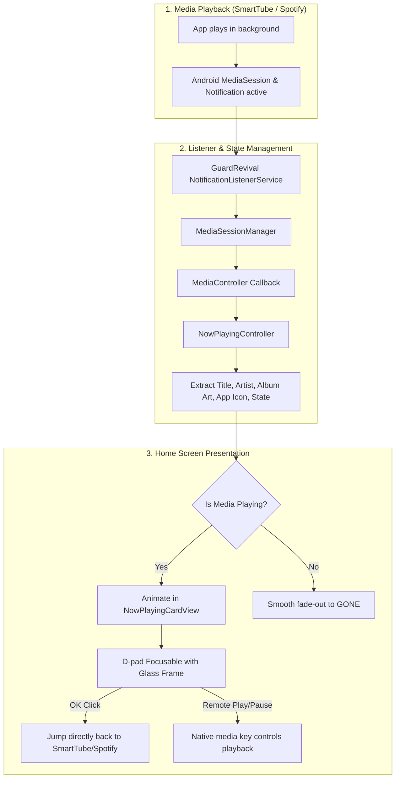

# Now Playing Frosted Glass Media Card Implementation Plan

## Goal Description
Implement an elegant, Apple TV / iOS dynamic island style **Now Playing Frosted Glass Media Card** on the CleanYourTV home screen, matching the user's finalized design mockup ([media_1794670566688_80fb1ba9.png](file:///C:/Users/Ashirwad/.gemini/antigravity/brain/ac9bb320-5a6e-4470-ab61-cbf4b61c0051/.user_uploaded/media_1794670566688_80fb1ba9.png) and [media_1794670575008_0f589b4e.jpg](file:///C:/Users/Ashirwad/.gemini/antigravity/brain/ac9bb320-5a6e-4470-ab61-cbf4b61c0051/.user_uploaded/media_1794670575008_0f589b4e.jpg)).

The card will float on the right side of the screen directly above the dock cards (across from the focused app title). When SmartTube, Spotify, YouTube Music, or any media app is playing audio/video in the background, the card automatically appears showing the high-resolution album art/thumbnail, an animated audio equalizer badge, the track/video title, the source app icon, and the artist/channel name. Per user specification, **it contains no media control buttons**, keeping the interface clean and minimal. It automatically dissolves away when playback stops.



---

## User Review Required

> [!IMPORTANT]
> **No Visible Control Buttons Confirmed:** As specified, the card does **not** render media buttons (`|<<`, `||`, `>>|`). It strictly adopts the clean, buttonless aesthetic of the close-up mockup.
> - **Clicking OK on the card:** Brings the user straight back into the playing video/song inside SmartTube, Spotify, or the active app.
> - **Remote Play/Pause Button:** Pressing the remote control's physical Play/Pause button toggles the background playback without needing on-screen buttons.

> [!NOTE]
> **Zero User Setup for Notification Access:** CleanYourTV already includes `GuardRevival` (`NotificationListenerService`) in its `AndroidManifest.xml` and runs `BridgeAdbManager` (loopback ADB). The launcher can automatically ensure `cmd notification allow_listener com.gathin.tvhome/.GuardRevival` is active without requiring the user to run any terminal commands or navigate hidden Android TV settings.

---

## Open Questions

> [!TIP]
> **Card Click Action:**
> - Default: Clicking OK on the card opens/resumes the app that is currently playing.
> - Alternative: Clicking OK toggles Play/Pause, while Long-Press OK opens the app.
> *(We plan to implement the default: OK opens the app, and standard remote Play/Pause toggles playback. Let us know if you prefer the alternative!)*

---

## Proposed Changes

### Component 1: Media Session & Notification Engine

Connects to Android's `MediaSessionManager` through `GuardRevival` and monitors active playback sessions in real time.

#### [MODIFY] `GuardRevival.java`
- Link `GuardRevival` to `NowPlayingController`.
- When `onListenerConnected()` fires, notify `NowPlayingController` of connection and register session callback.
- On `onNotificationPosted` and `onNotificationRemoved`, notify `NowPlayingController` of media notification updates (used as secondary fallback for apps with delayed MediaSession dispatch).

#### [NEW] `NowPlayingModel.java`
- Immutable data class holding:
  - `String title`: Video or song title.
  - `String artist`: Channel or artist name.
  - `String packageName`: e.g. `com.teamsmart.videomanager.tv`, `com.spotify.tv.android`.
  - `String appName`: e.g. "SmartTube", "Spotify", "YouTube Music".
  - `Drawable appIcon`: App icon drawable.
  - `Bitmap artBitmap`: High-resolution album art or video thumbnail.
  - `boolean isPlaying`: Whether the session is actively playing or paused.

#### [NEW] `NowPlayingController.java`
- Singleton manager coordinating between `GuardRevival`, `MediaSessionManager`, and `MainActivity`.
- Tracks active `MediaController` and registers `MediaController.Callback` for `onMetadataChanged` and `onPlaybackStateChanged`.
- Extracts high-resolution artwork (`METADATA_KEY_ALBUM_ART`, `METADATA_KEY_ART`, or notification icon).
- Auto-enables notification listener approval via `BridgeAdbManager` if not yet granted.
- Dispatches clean updates to UI thread listeners (`NowPlayingListener`).

---

### Component 2: Frosted Glass Now Playing Card UI

Custom view and layouts implementing the exact visual design from the user's mockup.

#### [NEW] `now_playing_card_bg.xml`
- Custom XML drawable creating the frosted glass effect:
  - Semi-translucent dark-glass gradient/fill (`#33FFFFFF` to `#1AFFFFFF` / blur-tinted).
  - Subtle `1px` white border (`#33FFFFFF`).
  - `22dp` corner radius matching the user's screenshot.

#### [NEW] `EqualizerView.java`
- Compact, hardware-accelerated 3-bar or 4-bar audio equalizer view:
  - Draws vertical rounded bars in `#FFFFFFFF`.
  - Animates heights rhythmically when `isPlaying == true`.
  - Freezes at gentle idle levels when paused.
  - Embedded directly inside a badge on the bottom-right corner of the album art.

#### [NEW] `NowPlayingCardView.java`
- Custom `FrameLayout` representing the complete Now Playing card:
  - Frosted glass container with `22dp` corners and clip-to-outline.
  - **Album Art:** `ImageView` (64×64dp, 12dp rounded corners) with embedded `EqualizerView` badge.
  - **Text Block:**
    - Title: `TextView` (white, `font_medium`, ~19sp, singleLine with auto-marquee when focused).
    - Subtitle: `LinearLayout` with small app icon (16×16dp) + `TextView` ("Artist • AppName", `#B3FFFFFF`, ~13sp).
  - **Focus & Motion:**
    - Smooth fade-in (300ms) with subtle scale expansion (0.95 to 1.0) on playback start.
    - Smooth fade-out (200ms) on playback stop.
    - Integrated with D-pad navigation: focusable, scalable (1.03x), and draws with launcher's glass highlight.

#### [MODIFY] `activity_main.xml`
- Insert `NowPlayingCardView` into `homeContent` directly above the dock container on the right side:
  ```xml
  <com.gathin.tvhome.NowPlayingCardView
      android:id="@+id/nowPlayingCard"
      android:layout_width="340dp"
      android:layout_height="wrap_content"
      android:layout_gravity="end"
      android:layout_marginEnd="8dp"
      android:layout_marginBottom="18dp"
      android:visibility="gone"
      android:focusable="true"
      android:clickable="true" />
  ```

---

### Component 3: MainActivity & Navigation Integration

Wires the controller, views, and D-pad remote interactions.

#### [MODIFY] `MainActivity.java`
- Initialize `NowPlayingController` in `onCreate()` and register listener.
- When `NowPlayingModel` updates:
  - If playing: bind data to `nowPlayingCard` and smoothly animate to `VISIBLE`.
  - If stopped: animate `nowPlayingCard` to `GONE`.
- **D-Pad Navigation Setup:**
  - When card is visible, configure focus navigation:
    - Pressing **UP** from the rightmost dock cards (cards 3 & 4: Hotstar, SmartTube) navigates to `nowPlayingCard`.
    - Pressing **DOWN** from `nowPlayingCard` returns focus to the dock cards.
    - Pressing **UP** from `nowPlayingCard` moves to header pills (`Settings`, `Inputs`).
    - Pressing **LEFT** from `nowPlayingCard` moves towards the left clock/RAM area or focused dock app.
- **Click Action:**
  - Clicking OK on `nowPlayingCard` triggers `nowPlayingController.openCurrentApp(this)`, smoothly resuming SmartTube / Spotify.
- **Remote Play/Pause Key:**
  - In `onKeyDown()` / `dispatchKeyEvent()`: if `KEYCODE_MEDIA_PLAY_PAUSE`, `KEYCODE_MEDIA_PLAY`, or `KEYCODE_MEDIA_PAUSE` is pressed on the remote, route directly to `nowPlayingController.togglePlayback()`.

---

## Verification Plan

### Automated Tests
1. **Unit Tests for Model & Controller:**
   - Create `NowPlayingModelTest.java`: Verify model creation, equality, and formatting of `"Artist • AppName"`.
   - Create `NowPlayingControllerTest.java`: Verify active session parsing, metadata extraction, playback state changes, and callback dispatch.
2. **Execution:**
   ```bash
   cmd.exe /c "set JAVA_HOME=C:\Program Files\Android\Android Studio\jbr && gradlew.bat testDebugUnitTest"
   ```
   *Expected:* All unit tests pass with zero failures.

### Manual Verification (On Connected TV `192.168.1.37:5555`)
1. **Build & Deploy:**
   - Assemble debug APK: `gradlew.bat assembleDebug`.
   - Install to TV: `adb install -r launcher/app/build/outputs/apk/debug/app-debug.apk`.
2. **Verify SmartTube Background Audio:**
   - Open SmartTube on the TV, play a video (e.g. music or podcast).
   - Press the remote's **Home** button to return to the launcher.
   - Verify:
     - The frosted glass Now Playing card smoothly appears on the right side above the dock.
     - Video thumbnail is displayed with the animated equalizer badge in the corner.
     - Video title and `Channel • SmartTube` text match the playing video.
     - The card has NO control buttons, matching the mockup.
3. **Verify D-Pad Remote Navigation:**
   - Press D-pad **UP** from the dock cards: verify focus lands cleanly on the Now Playing card with smooth glass highlight.
   - Press **OK**: verify SmartTube opens immediately back to the playing video.
   - Press **Play/Pause** button on the physical TV remote: verify audio pauses and resumes cleanly.
4. **Verify Playback Stop & Auto-Hide:**
   - Pause or exit playback in SmartTube: verify the Now Playing card smoothly fades out and disappears completely, leaving the home screen clean.
5. **Capture Verification Screenshot:**
   - Take an adb screenshot of the live home screen with the Now Playing card active to confirm pixel-perfect visual match with the user's design.
